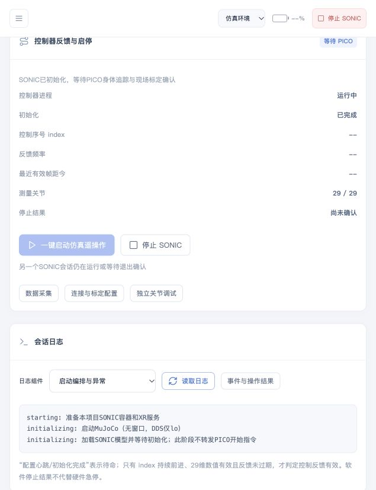

# Robot Station 首次使用 SOP

版本：草案 v0.1｜更新：2026-10-20｜读者：已安装工作台、首次连接PICO/G1的用户

上一份文档：[安装 SOP](INSTALLATION_SOP.md)。本文顺序是**网页检查 → MuJoCo仿真 → PICO遥操作 → 相机 → 采集/回放 → 真机现场验收**。没有G1时可以先做仿真；没有PICO时可以先验证控制器初始化和停止。

**当前软件闭环已在4070完成隔离仿真测试；真实PICO4、腿部追踪、G1运动与完整现场采集尚待验收。PICO客户端的确切版本、按钮截图和最终安装入口会在发布验收后补齐。** 本文不把待验证的设备结果写成已通过。

## 0. 开始前确认

- [ ] 已完成安装SOP，正式网页能打开，未进入 `?preview=1` 合成演示。
- [ ] 知道本机Robot Station与SONIC的实际安装目录。
- [ ] 首先选择“仿真环境”；不要因为设备离线就尝试切换真机并点击启动。
- [ ] 同一时间只使用一种动作控制源，其他手动控制、采集或软件准备任务已结束。
- [ ] 如需PICO，准备PICO4和两个腿部追踪器，确认设备有电并完成官方配对。

### 0.1 这些状态是什么意思

| 页面信息 | 代表什么 | 不能据此认为什么 |
| --- | --- | --- |
| 绿色Connecting | 浏览器连通工作站后端 | 不代表G1、PICO或相机已连接 |
| SONIC容器就绪 | GPU运行环境容器可用 | 不代表策略正在运行 |
| XR运行中 | PC Service及本机连接就绪 | 不代表人体追踪/标定通过 |
| 初始化完成、等待PICO | C++控制器完成初始化，等待输入 | 不代表已经执行策略 |
| 控制反馈有效 | 连续递增控制序号与有效29维关节数据，帧龄≤500ms | 不代表真机动作或停止效果已经现场验收 |
| 绘制FPS | 浏览器实际绘制速度 | 不是物理步进或新姿态更新频率 |
| 姿态Hz | 浏览器应用新时间戳测量姿态的频率 | 不是后台DDS/策略频率 |

当前网页每2秒取得一次快照，因而可能同时显示约30 FPS与约0.5 Hz姿态更新。此时旋转视角可以流畅，人体动作更新仍会跳变。高频推送与完整MuJoCo场景视频尚未实现；网页现在显示测量关节的URDF模型。

## 1. 启动并检查工作台

1. 在实际Robot Station目录打开终端，运行 `./run.sh`。
2. 在这台电脑浏览器打开 **[http://127.0.0.1:9999/](http://127.0.0.1:9999/)**。
3. 如果地址带 `?preview=1`，先退出预演；正式操作必须读取真实后端。
4. 进入“自检与启动”，刷新/执行只读自检，先看GPU、Docker、模型、运行环境是否通过。
5. 无设备时，PICO、相机、电量和G1反馈可以显示等待/未知；按后面的步骤逐一接入。

“软件准备”只检查和准备环境。**启动SONIC控制器要到“SONIC遥操作”页操作。** 独立滑条控制在“全身控制”页，不是PICO遥操作的必经步骤，也不需要先设置一个工作台初始姿态再交给SONIC。

## 2. 第一次先做无PICO的MuJoCo检查

### 2.1 设置仿真配置

1. 确认所有托管控制/采集任务已停止，再进入“连接与诊断”。运行中修改配置会被拒绝。
2. 切换到“仿真环境”，核对下表。没有现场标定时不要勾选PICO标定确认。
3. 需要修改时保存，并按页面提示重新接入只读数据。

| 项目 | 仿真配置 |
| --- | --- |
| Unitree DDS网卡 | `lo`，只在本机回环运行 |
| Unitree DDS Domain | `0`；当前SONIC C++不支持改成99 |
| SONIC姿态输入 | 默认 `tcp://127.0.0.1:15556` |
| SONIC状态反馈 | 默认 `tcp://127.0.0.1:15557` |
| PICO标定确认 | 未实际标定时保持未确认 |

输入和反馈必须是不同的本机回环端口；端口冲突时按连接配置更换，不要重复启动第二份程序。

### 2.2 一键启动

1. 进入“SONIC遥操作 → 仿真遥操作”。
2. 点击“一键启动仿真遥操作”一次，等待状态变化。
3. 后台依次准备Docker和XR、启动无窗口MuJoCo、加载SONIC控制器，网页显示启动/初始化阶段。
4. 等待进入“初始化完成、等待PICO”。没有PICO时停在这里正常；不要求控制序号已经递增。
5. 如需查看进度，在“会话日志”选择“SONIC控制器”或“启动编排与异常”，点击“读取日志”。

**通过标志：** 控制器进程运行、初始化完成；MuJoCo测量关节能显示时为29/29。模型只是参考姿态、时间不更新时，说明测量尚未有效，不能仅凭模型出现在页面就算通过。



图片是2026-10-20开发版真实软件状态示例，不是最终安装器截图，也不是PICO已连接的证明。

### 2.3 验证停止

1. 点击控制器的“停止”或“停止SONIC”。
2. 等待“进程退出已确认”，再进行下一步。
3. Docker/XR可以保持待命；测试用控制器、Manager和MuJoCo应随会话结束。

**通过标志：** 控制器未运行、停止确认完成、允许再次启动。若显示退出未确认，保留日志并按故障表处理，不要反复点启动、强杀容器或切换环境绕过占用。

## 3. 连接PICO并在仿真里验证动作

### 3.1 网络连接

1. 让开发机和PICO接入同一可达的局域网，避免访客Wi-Fi或客户端隔离。
2. 在Ubuntu“设置 → 网络/Wi-Fi”查看连接PICO的网卡IPv4地址，记录为“开发机PICO侧IP”。也可在终端用下列命令查看：

```bash
ip -brief address
```

3. 开发机有两张网卡时，不要把G1专用口地址和PICO所在网络地址混淆；PICO客户端应连接PICO侧可达地址，不填写 `127.0.0.1`、网页端口9999或另一台电脑的旧IP。
4. “相同Domain”不负责跨VLAN路由；先用同一可达网段验证。跨VLAN时按现场网络方案设置路由/发现，不通过随意改DDS域解决。

### 3.2 连接XR与标定

1. 在网页“SONIC遥操作”中启动XRoboToolkit PC Service。
2. 在PICO打开与发布包匹配的XRoboToolkit客户端，允许其正常追踪所需权限，按客户端连接界面填写/选择开发机PICO侧IP并连接。确切应用版本与该界面截图是发布前必补项；不要猜测其他应用的地址格式或端口。
3. 按PICO/追踪器官方流程完成两个腿部追踪器配对、身体尺寸/全身标定，确认身体追踪已开启。
4. 如需在Ubuntu查看Unity重定向效果，打开Unity 3D入口。**网页“启动XR”只启动PC Service，不自动打开Unity窗口。**
5. 在Unity中核对头、左右手、躯干及腿部动作方向，确认不是只有头显/手柄在更新。Unity窗口有模型也不能代替SDK收到新身体数据。

当前开发目录布局下，可在Ubuntu图形桌面的终端执行下面命令打开Unity；安装目录不同时换成真实SONIC目录。没有桌面显示的SSH终端不适合用来验证Unity窗口：

```bash
cd "$HOME/workspace/sonic_deploy"
./run_xrobotoolkit.sh 3d
```

Unity/PICO校准具体按钮、截图及预期人体姿态需要现场验证后补齐；遇到客户端版本或动作方向不符，应先处理，不进入后续开始控制步骤。

### 3.3 保存标定确认，再启动会话

1. 确认第2节的仿真会话已停止。
2. 在“连接与诊断 → 仿真环境”勾选已实际完成的PICO标定确认，保存并按提示重新接入。
3. 返回“SONIC遥操作 → 仿真遥操作”，点击“一键启动仿真遥操作”。
4. 等待身体追踪新帧与初始化完成。后台只有在身体数据新鲜（≤500ms）且标定已确认后，才启动原PICO Manager。
5. 就绪后按原SONIC手柄操作：**A+X切换Planner/姿态模式，A+B+X+Y切换策略开始/停止**。两组是组合键，以当前版本日志提示为准；姿态映射验证选择姿态模式。首次先做小幅、缓慢动作，不要一上来大幅移动。

Planner模式不是人体所有关节的逐关节复制；姿态模式也会经过重定向和策略约束，不应要求人体角度与机器人角度完全一致。

**通过标志：** PICO身体追踪有效、控制序号持续递增、控制反馈有效、机器人测量姿态与动作对应。若只有进程/配置心跳或Unity动画，不能算SONIC闭环通过。页面约0.5Hz更新仍可能显得跳变；确认后台反馈与前端更新频率时使用各自指标。

### 3.4 结束仿真

通过网页点击“停止SONIC”，等退出确认。软件会在追踪/输入/反馈异常时请求停止；故障后不会自动重新接管，需要排查后显式启动。先做完这个流程，再进入相机/采集或真机测试。

## 4. 三路相机首次接入

本节要求相机发布进程已在G1端或现场指定主机运行。工作台只订阅图像，不会自动安装或启动未知相机驱动。

1. 停止控制/采集任务后，在“连接与诊断”选择要使用的运行环境。
2. 选择ROS2相机来源，默认图像Domain **99**；Unitree机器人DDS仍为 **0**。
3. 向发布端维护人员确认三路实际topic、消息类型与QoS，再填写配置。下表只是默认模板。

| 视角 | 默认topic | 默认消息类型 |
| --- | --- | --- |
| 头部 | `/camera/head/image_raw` | `sensor_msgs/msg/Image` |
| 左腕 | `/camera/left_wrist/image_raw` | `sensor_msgs/msg/Image` |
| 右腕 | `/camera/right_wrist/image_raw` | `sensor_msgs/msg/Image` |

如果发布的是压缩图，topic和类型应同步调整为实际的 `sensor_msgs/msg/CompressedImage`。默认订阅best_effort/depth 5；与发布端QoS核对，不能只改topic字符串。图像时间戳需要有效、持续更新，发布端和工作站时钟须同步。

4. 保存配置，在“整机管理 → 相机接入”启动，再进入“传感器”检查。
5. 分别遮挡或移动每一台相机，核对头部/左右腕映射，避免三路接反或显示同一路。

**通过标志：** 三路都有持续更新的真实图像，帧率/帧龄可见；不是演示视频、静止旧帧或只有topic名称。无机器人时可由另一个经过配置的ROS发布端验证图像，但不能据此宣称G1相机链路已通过。

## 5. 采集、回放与格式转换

### 5.1 先录一个短片段

1. 选定采集环境，确认同一模式的PICO、SONIC有效反馈、完整关节与三路图像均就绪。不要通过切换环境绕过采集门槛。
2. 如需更改相机或标定配置，先停止任务保存配置，再重启相应链路。
3. 进入“数据采集”，填写数据集名称、任务说明及采样配置，选择新数据集，不覆盖重要旧数据。
4. 点击“准备采集”，等待采集进程确认就绪。
5. 点击“开始录制”，先录制约5～10秒的小片段，确认计时/帧数在增加。
6. 点击“保存”，等待后台确认；不要在保存过程中关闭网页服务或断电。
7. 本次不需要的片段用“舍弃”；当前实现会保留片段并标为舍弃，不等于物理删除文件。
8. 已无待保存片段后点击“结束采集任务”。结束录制任务不等于结束SONIC运动，会话还需按第7节停止。

### 5.2 回放

1. 进入“数据回放”，刷新数据集和片段列表，选择刚保存的片段。
2. 检查三路视频、状态/动作曲线与姿态是否对应同一时间。
3. 拖动时间轴，测试暂停/继续，确认头尾均有合理内容。

**通过标志：** 正式片段能完整播放，三路方向正确、状态时间合理。回放只读，不会把片段动作发送给机器人。

### 5.3 转换与保留原数据

1. 确认采集已结束，进入“数据转换”。
2. 选择刚结束且完整的数据集、目标格式和新的输出任务。
3. 等待任务成功，再核对输出路径或下载结果；失败时查看任务错误，保留源数据。

当前原生数据是**LeRobot v2.1的Parquet + MP4 + meta文件**。HDF5输出采用本项目 `sonic-hdf5-v1`，并非所有训练框架通用布局；另存LeRobot是校验后复制v2.1，不会自动变成v3。当前任务模型推理和后台状态机执行仍待接入，不列入新手首次使用的成功标准。

## 6. G1真机：完成现场验收后再开始

**本节是现场核验入口，当前不是可供完全无经验人员直接执行的运动教程。** 正式发布前须由熟悉G1的现场人员完成本机型的站姿、手部、停止与参数验证，再补齐真机操作截图及独立验收记录。

1. 先结束仿真、独立手动控制与采集，确认停止。
2. 按现场方案接G1有线口，核对机器人型号、29自由度和未锁腰条件。当前项目针对完整29自由度版本，不套用于23自由度或锁腰机型。
3. 现有示例是工作站有线 `192.168.123.100/24` 对G1 `192.168.123.164`；在新现场先确认实际地址和无IP冲突，不无条件复制。
4. PICO可走另一张网卡接路由器；也可按已验证网络方案放同一局域网。网页访问地址和网卡名称按本机配置。
5. 在“真机环境”先做只读连接和自检，确认真实29维反馈/BMS。顶栏电量未知时核对实际BMS话题/固件，不填假电量。
6. SONIC真机启动需要**该工作站本次开机有效的SONIC专项现场授权**。它与“全身控制”的独立SDK关节标定不同，不能互相替代，也不能从别的机器复制。
7. 现场验收按 [SONIC控制器说明](docs/sonic_controller.md) 执行，覆盖默认站姿、Dex3手部配置/动作、增益限位、正常停止和物理急停。SONIC启动本身会进入站姿并动作手部，不是只启动一个无动作后台进程。
8. 授权有效、独立停止条件和现场人员就绪后，才进行网页的真机单次启动确认。按钮禁用时先读原因，不改布尔值或移除校验来放行。

独立SDK滑条测试仅用于可靠机械支撑下的关节调试，不用于自由站立平衡，不作为SONIC启动前置姿态。详见 [SDK适配与现场标定](docs/g1_sdk_adapter.md)。

## 7. 每次结束的顺序

1. 保存或舍弃当前片段，等待完成，然后结束采集任务。
2. 通过当前会话“停止SONIC”结束控制，等待退出确认。若实际机器人运动异常，按已验收的现场物理停止流程处理，不能仅等待网页按钮返回。
3. 需要关闭基础服务时，再停止XR、SONIC容器；XR停止会同时关闭本项目Unity。
4. 最后在工作台目录执行 `./stop.sh`，按官方G1关机流程处理真机。不要把关浏览器、退出PICO或停止容器当作机器人已机械停止的证明。

全局停止会请求停止本工作台的准备/采集/手动调试/托管SONIC，不能接管外部控制器，也不能代替物理急停。`./stop.sh`保留下次开机自启动；开机不会自动恢复运动。

## 8. 首次使用常见问题

| 现象 | 按顺序检查 | 继续条件 |
| --- | --- | --- |
| Connecting绿色但其他设备离线 | 按第0.1节区分后端与设备状态，再检查各接入项 | 对应设备实际数据新鲜 |
| 无PICO时一直等待PICO | 第2节这是正常待命状态 | 初始化/停止检查通过；有PICO再做第3节 |
| PICO显示已连但身体追踪无效 | 客户端版本/开发机PICO侧IP、追踪权限、腿部配对、全身标定；不能只看头显姿态 | 身体追踪新帧被SDK读到 |
| 已做标定但Manager不启动 | 停止会话后核对当前模式的标定确认并保存；检查身体帧龄 | ≤500ms新身体数据且标定确认有效 |
| Unity没出现 | 网页XR启动只开PC Service；在Ubuntu图形桌面用Unity入口 | Unity实际打开；不要因此启动第二份PC Service |
| 模型静止但显示约30FPS | 看姿态Hz、测量时间与控制序号；绘制FPS不会证明策略运行 | 新测量/输入更新、正确模式和开始操作 |
| 一键启动/停止按钮禁用 | 悬停看原因；检查另一模式会话、手动控制、采集/准备或未确认退出 | 释放占用并确认退出，不重复启动 |
| 图像topic存在但没有画面 | 检查Domain99、类型、QoS、路由/发现、时间同步和新帧 | 三路实际新图像持续到达 |
| 采集按钮禁用/录制中断 | 看就绪条件、三路图像、追踪/反馈帧龄及导出日志 | 各条件真实满足后开始新片段；保留不完整输出 |
| 真机启动显示现场验收未完成 | 按第6节由现场人员验证，保持输出关闭 | 有效本机SONIC授权与网页单次确认 |
| 停止退出未确认 | 保留当前会话和日志，核对进程状态；真机按物理停止方案处理 | 明确确认退出后再允许启动 |

会话日志入口在“SONIC遥操作”；工作台日志可在项目目录执行 `./run.sh logs`。记录问题时只提供必要的版本、步骤和脱敏报错，不发送密钥、密码、Cookie或现场授权文件。

## 9. 首次使用验收记录

| 检查项 | 结果/日期/证据 |
| --- | --- |
| 正式网页连接、自检及服务启停 | 待填写 |
| 仿真初始化、29维测量与正常停止 | 待填写 |
| PICO4 + 两个腿部追踪器、Unity与SDK身体数据 | 待现场验证 |
| PICO → SONIC → MuJoCo动作及停止 | 待现场验证 |
| 三路真实相机方向、时间与预览 | 待现场验证 |
| 短片段保存、回放、格式转换 | 待现场验证 |
| G1真实反馈/BMS、专项启动/停止验收 | 仅现场专业人员填写；未验证保持关闭 |

正式发布前需要补齐PICO/Unity版本与逐步截图、真机现场记录，以及一位未参与开发的新手不使用AI按两份SOP完成安装和仿真使用的结果。相关交付条件见 [分发计划](docs/distribution_plan.md)。
