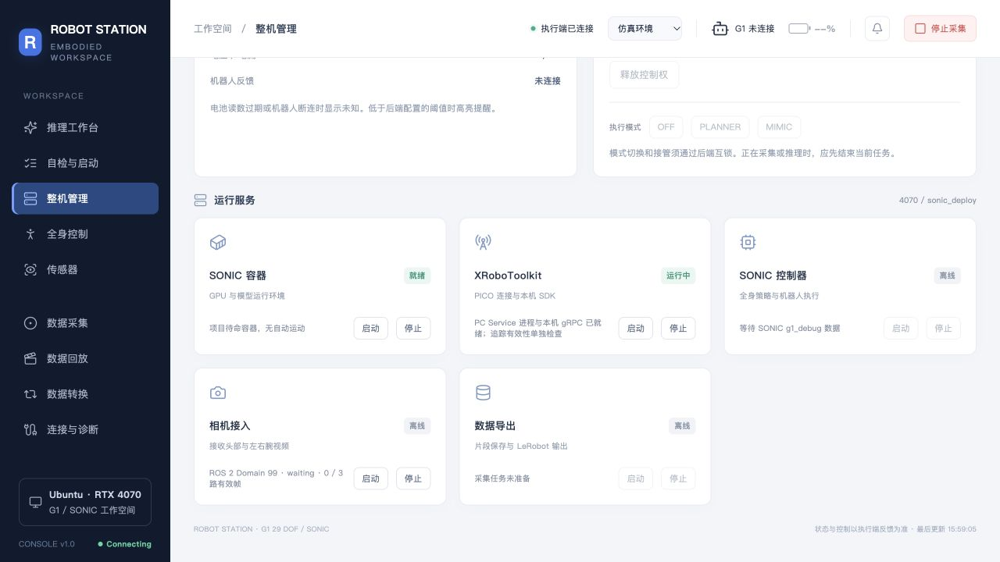

# Robot Station RBM

面向 **Unitree G1 29 自由度机器人**的网页工作台，整合 SONIC / PICO 遥操作准备、设备状态、三路相机、数据采集、回放与格式转换。

A browser-based workstation for Unitree G1: device monitoring, SONIC service management, teleoperation data collection and dataset tools.

[快速预览](#快速预览无需机器人) · [完整部署](#ubuntu-工作站部署) · [功能状态](#功能与当前状态) · [接口与开发](#接口与开发) · [操作文档](#文档导航)

> 当前为开发版本。网页与离线数据链路已验证，真机动作、相机接线和 PICO 追踪仍须现场验收；任务模型推理、后台状态机执行及 `.deb` 安装包尚未交付。更新日期：2026-10-20。



## 快速预览：无需机器人

只需 **Python 3.10+** 和支持 WebGL 的现代浏览器。前端依赖随仓库提供，无需 npm 安装或 GPU。

```bash
git clone https://github.com/Curry-ZHR/Robot_Station_RBM.git
cd Robot_Station_RBM
python3 -m http.server 18080 --bind 127.0.0.1 --directory apps/static
```

打开 **[http://127.0.0.1:18080/?preview=1#startup](http://127.0.0.1:18080/?preview=1#startup)**，体验启动向导、29 关节模型、三路演示视频、采集/回放和状态机本地预演。终端按 `Ctrl+C` 关闭。

也可 [下载 main 分支 ZIP](https://github.com/Curry-ZHR/Robot_Station_RBM/archive/refs/heads/main.zip)，解压后在项目根目录执行上面的 Python 命令。

**保留 `?preview=1`。** 此模式的电量、姿态、视频与任务结果均为合成演示，不向设备发送指令、不写正式采集数据。静态服务器不提供后端 API；去掉该参数会显示执行端连接失败。不要直接双击 HTML 打开。

## 功能与当前状态

| 功能 | 已实现内容 | 当前验证边界 |
| --- | --- | --- |
| 自检与启动 | GPU、Docker、模型、存储、网络检查，分步软件准备 | 已验证 4070；准备软件不会自动启动真机运动 |
| 整机管理 | 项目所属 SONIC 容器、XRoboToolkit PC Service / Unity 启停 | 实际停止、重启已验收；活动任务及外部控制器会阻止停止 |
| 机器人状态 | 具名关节反馈、控制源状态、DDS BMS 电量订阅 | SDK 已适配；真实反馈/BMS 主题及固件须现场核验 |
| 全身控制 | G1 29 维滑条、三维模型、姿态库、MuJoCo 平滑目标跟踪 | 仿真已验证；独立真机输出受本地标定和授权门槛限制 |
| 三路相机 | ROS 2 Image / CompressedImage → ZMQ → 网页预览与采集 | Domain 默认 99；实际 topic、QoS、网络与时间同步待现场确认 |
| 数据采集 | 官方 SONIC 导出器，片段开始、保存、丢弃、结束 | 合成输入下完成真实导出器闭环；物理设备采集待验收 |
| 数据回放 | 三路视频、状态/动作曲线、片段列表与人工评级 | 已验证；采集质量自动评分暂缓 |
| 数据转换 | SONIC 原生 LeRobot v2.1 → HDF5，或校验后另存 LeRobot v2.1 | 已完成离线测试；不自动转换为 LeRobot v3 或 ACT 专用格式 |
| 推理页面 | 任务模型与 SONIC 全身控制分区、配置及接口约定 | 任务模型服务与动作执行链路仍待接入 |
| 状态机 | 节点/连线编辑、校验、JSON 导入导出、本地预演 | 后台节点执行尚未实现 |
| 常驻运行 | `run.sh` / `stop.sh`、systemd 用户服务、日志与进程恢复 | 已部署 4070；可迁移 `.deb` 包待制作与验收 |

网页左下角绿色 **Connecting** 表示浏览器已连通工作站后端。G1、电量、相机、PICO 和控制器各有独立状态，不能用这一标识判断真机已就绪。缺少真实反馈时，正式页面显示未知或离线。

## 架构与部署分工

```text
浏览器 ── HTTP ── 4070 工作站 / Robot Station
                       ├── 网页、设备诊断、采集、回放、转换
G1 相机 ── ROS 2 ───────┤── 图像订阅 → ZMQ → 预览 / 录制
PICO ── XRoboToolkit ───┤── 人体追踪与 SONIC 遥操作接入
G1 ── 有线 / Unitree DDS ┤── 状态与 BMS 订阅、受控动作下发
                       └── 任务模型接入（规划：HPC / 4090 / 4070）
```

当前验证基础是工作站运行 SONIC 程序，通过 Unitree DDS 与 G1 通信。将模型放在 HPC / 4090 / 4070、由工作站统一调度，以及让 G1 侧执行器接收 motion token，是后续部署规划；原厂 G1 不会自动识别任意 motion token。详见 [计算与执行分工](handoff_distribution.md)。

## Ubuntu 工作站部署

### 运行条件

完整链路当前面向 **Ubuntu 22.04 x86_64 / Python 3.10 / ROS 2 Humble**。已验证环境为 RTX 4070 工作站；其他系统与 GPU 尚未完成安装验收。只预览网页时，使用前面的轻量入口即可。

按需要准备以下组件：

| 组件 | 用途 |
| --- | --- |
| 已配置的 `sonic_deploy`、`.venv_teleop`、模型和构建产物 | SONIC 适配层及默认常驻服务的 Python 环境 |
| Docker、NVIDIA 驱动及对应容器运行环境 | SONIC 容器 |
| Unitree SDK / DDS 运行依赖 | G1 状态、电池与独立关节适配 |
| XRoboToolkit PC Service、SDK、Unity 客户端、PICO | 人体追踪和 Unity 可视化 |
| ROS 2 Humble、`cv_bridge`、OpenCV、`sensor_msgs`、RMW | 三路图像订阅 |
| `uv`、`ffmpeg` / `ffprobe`、`tmux` | 独立采集环境、视频处理与 SONIC 进程管理 |
| systemd 用户服务及用户驻留 | 工作台开机自启动 |

**本仓库不包含 SONIC 容器镜像、模型权重、完整 XR 安装包、运行虚拟环境或采集数据。** 目前不能在干净系统上仅克隆本仓库就完成全部硬件部署；依赖可迁移打包见 [分发计划](docs/distribution_plan.md)。

推荐目录：

```text
workspace/
├── robot_station/       # 本仓库，克隆目录可自行命名
└── sonic_deploy/        # 单独准备的兼容 SONIC 部署
    ├── .venv_teleop/
    ├── gear_sonic/
    ├── gear_sonic_deploy/
    └── outputs/         # 采集源数据与转换输出
```

### 安装工作台辅助环境

在本仓库根目录执行，按需选择。以下脚本不替代 SONIC / ROS / Unitree SDK 的安装：

```bash
export SONIC_REPO_ROOT=/absolute/path/to/sonic_deploy

# 采集：要求兼容的 SONIC 源码、teleop 环境及 uv 已就绪
bash scripts/install_collection.sh

# 离线格式转换：独立 Python 环境
bash scripts/install_conversion.sh

# ROS 图像桥：要求系统 ROS 2 Humble、cv_bridge 等已安装
bash scripts/install_ros2_camera.sh

# XR 启停扩展：要求兼容的 SONIC 启动器和 XR 运行文件已安装
bash scripts/install_xrobotoolkit_lifecycle.sh "$SONIC_REPO_ROOT"
```

XR 安装器会备份旧文件，并拒绝覆盖不兼容或无关改动，详见 [集成说明](integrations/sonic/README.md)。

### 启动、停止与自启动

在兼容环境中执行：

```bash
export SONIC_REPO_ROOT=/absolute/path/to/sonic_deploy
./run.sh
./run.sh status
./run.sh logs
```

默认服务监听 `0.0.0.0:9999`，本机访问 [http://127.0.0.1:9999/](http://127.0.0.1:9999/)，现有 G1 网段部署入口为 [http://192.168.123.100:9999/](http://192.168.123.100:9999/)。网页启动不自动取得机器人控制权或开始运动。

首次运行自动安装、启用 `robot-station.service` 用户服务；启用用户驻留时可能需要本机 sudo 授权。它随开机运行，主管进程恢复网页及配置允许的只读接入。服务安装时会记录 SONIC 的绝对路径，迁移目录后须重新运行安装脚本。

```bash
./stop.sh                       # 关闭工作台及其托管任务，保留下次开机自启
./run.sh restart
./run.sh disable-autostart       # 取消自启，当前服务继续运行
```

`stop.sh` 不停止外部 SONIC 控制器、Docker 或 XR 进程。基础服务启停使用“整机管理”页面；Docker 停止仅允许本项目所属且空闲的容器，XR 停止会同时关闭对应 PC Service 与 Unity。网页重新启动 XR 只恢复 PC Service，Unity 通过已有 `3d` 入口单独打开。软件停止按钮不等于机器人硬件急停。

局域网远端操作需要工作站生成的操作密钥授权；本机及 SSH 隧道访问按本机权限处理。密钥、会话和真机标定授权不得加入 Git。当前入口用于可信局域网，不应直接发布到公网。

### 网络与连接配置

- 工作站有线口可使用 `192.168.123.100/24`，与 G1 `192.168.123.164` 通信；使用前确认地址无冲突。
- 工作站另一网口接入 PICO 所在局域网。相同 ROS Domain 不会自动打通 VLAN，仍需可达路由及 DDS 发现配置。
- ROS 相机默认 `ROS_DOMAIN_ID=99`；Unitree DDS 默认 Domain **0**，二者分开配置。
- 默认三路 topic 为 `/camera/{head,left_wrist,right_wrist}/image_raw`，仅是模板，须按实际发布端修改。
- 在网页“连接与诊断”配置网卡、topic、消息类型、QoS 与地址，模板见 [console-runtime.example.json](apps/console-runtime.example.json)。

默认公开 Host 为 `192.168.123.100`。换用其他工作站 IP 时，需同步调整 `~/.config/systemd/user/robot-station.service` 中的 `ROBOT_STATION_PUBLIC_HOST`，执行 `systemctl --user daemon-reload` 后重启；重新运行安装器会恢复模板值。仅设置 `DATA_PLATFORM_HOST` 不会修改该 systemd 服务。

## 数据格式

本项目使用的 **SONIC VLA 官方采集链路原生输出 LeRobot v2.1**：`data/` 下的 Parquet、`videos/` 下的 MP4，以及 `meta/` 中的 JSON / JSONL 和模态说明。完整状态/动作可包含手部共 43 维，网页身体控制为 29 维，二者不能直接按索引混用。

“数据转换”读取已结束且完整的数据集，生成独立输出，保留源数据：

- **HDF5**：项目定义的 `sonic-hdf5-v1`，每片段一个文件，可保留 MP4 字节或解码为 RGB；不是通用 ACT / Robomimic 布局。
- **LeRobot**：校验后另存完整 v2.1 副本，保留原字段、手部及舍弃标记；不自动升级 v3。

详见 [采集、回放与转换约定](docs/data_collection_console.md)。

## 接口与开发

当前接口为 **OpenAPI 3.1 / console API 1.6.0**，包含 34 个路径、43 个 schema。前端采用原生 ES Modules + Three.js，后端采用 Python HTTP 服务与独立工作进程。

- [OpenAPI 规范](apps/contracts/console-v1.openapi.json) 与 [生成器](apps/contracts/build_contract.py)。
- 接口前缀 `/api/v1/console`；通过能力字段、状态快照和 `x-implementation` 判断实际支持范围。
- 写入保留授权、同源 CSRF、版本检查与幂等；手动控制另有私有租约与递增序号。
- 真机适配的本地标定门槛不能通过网页绕过，按 [Unitree SDK 接入与现场验收](docs/g1_sdk_adapter.md) 操作。

```text
apps/                   当前 G1 网页、API、设备适配、工作进程与测试
apps/static/            前端、模型与演示资源、随附第三方库
apps/contracts/         接口规范与生成源
integrations/sonic/     可复现安装的 XR 生命周期扩展
scripts/                辅助环境安装、ROS 桥接、systemd 安装
docs/                   操作说明、分发计划、脱敏验收证据
run.sh / stop.sh        当前工作台常驻入口
run_legacy_ros.sh        保留的历史 ROS 平台启动器
```

根目录原有 `frontend/`、`backend/`、`modules/`、`ros_packages/` 保留历史平台实现。当前 G1 工作台在 `apps/` 维护；普通 G1 使用不需要执行 `run_legacy_ros.sh` 或构建历史硬件包。

前端测试（需要 Node.js 22.7+）：

```bash
node --test apps/tests/console.test.mjs
```

后端完整测试需要上述采集、转换、ROS 与 SDK 测试依赖。准备好环境后运行：

```bash
cd apps
PYTHONPATH="$PWD:$PWD/tests" .venv_collection/bin/python -m unittest discover -s tests -v
```

最近一次验收：**112 项后端测试、19 项前端测试通过**；实际 API 验证了 SONIC 待命容器与 XR 的停止及恢复，未执行真机运动。证据见 [服务生命周期验收](docs/references/service-lifecycle-20261020/README.md)。离线测试通过不代表真实设备标定完成。

## 文档导航

| 文档 | 内容 |
| --- | --- |
| [运行与维护](docs/station_operations.md) | 常驻服务、日志、连接诊断、姿态库及操作流程 |
| [后端接入](docs/data_collection_console.md) | API、ROS 图像桥、采集、回放、转换与测试 |
| [SONIC / XR 启停](docs/service_lifecycle.md) | 停止范围、阻止条件、升级依赖与接口 |
| [Unitree SDK 适配](docs/g1_sdk_adapter.md) | 29 关节映射、现场标定、授权和实机验收 |
| [计算与执行分工](handoff_distribution.md) | HPC / 4090 / 4070 / G1 的当前职责与目标架构 |
| [安装包分发计划](docs/distribution_plan.md) | `.deb`、资源分发与干净环境验收要求 |
| [开发交接](HANDOFF.md) | 最新进展、历史决策与待办，按最上方最新阶段阅读 |

## 反馈与第三方资源

欢迎通过 [GitHub Issues](https://github.com/Curry-ZHR/Robot_Station_RBM/issues) 报告问题，附操作步骤、系统/组件版本和脱敏报错；不要提交操作密钥、会话、现场授权或私人采集数据。

Three.js、Lucide 随附许可证位于 [apps/static/vendor](apps/static/vendor)；SONIC、Unitree SDK、G1 模型及其他依赖遵循各自上游的许可与使用条件。本仓库目前未提供覆盖全部代码和资源的统一许可证，使用或再分发时请分别核对。
