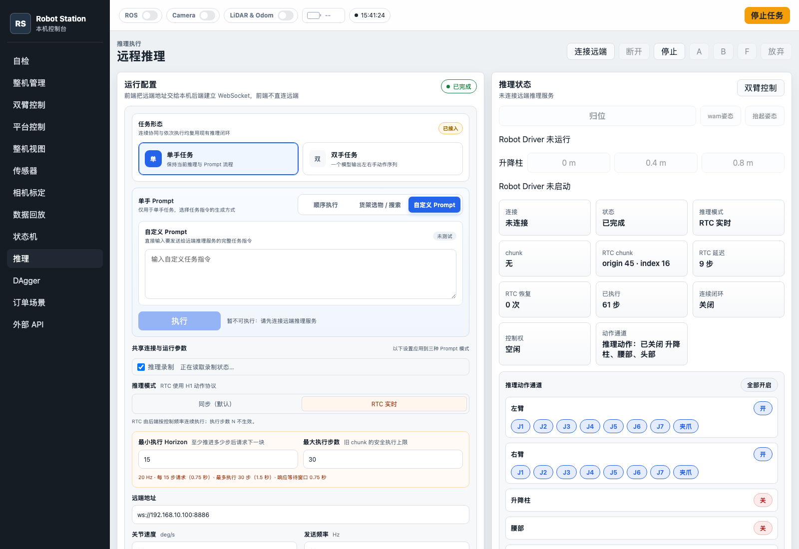
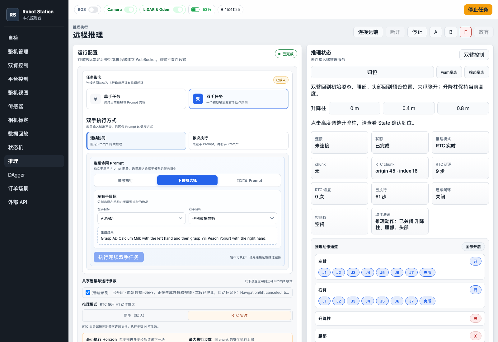
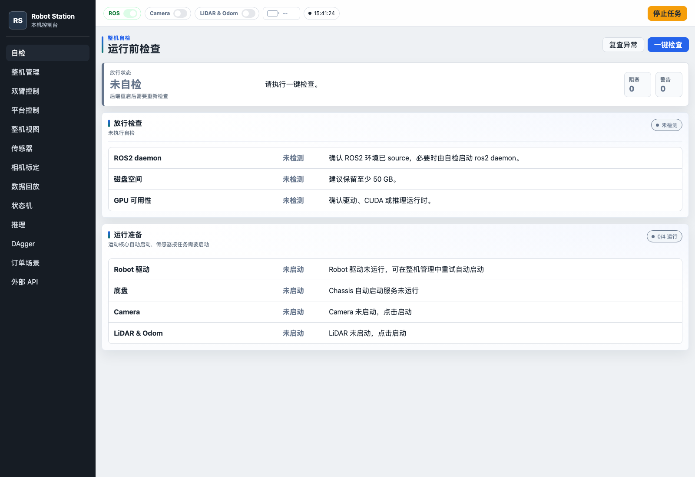
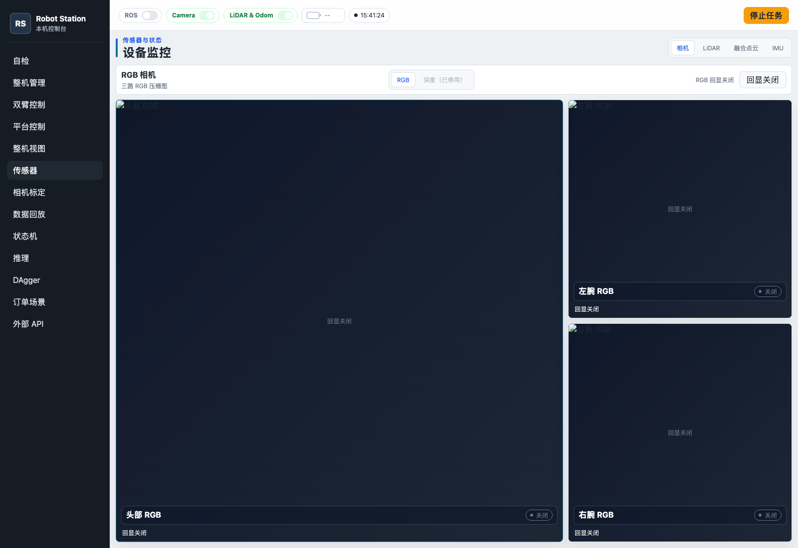
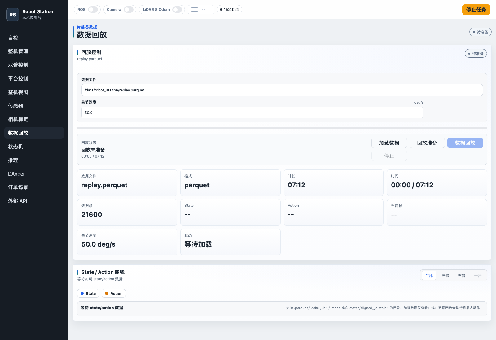

# 192.168.10.46:9999 工作台参考

观察日期：2026-10-15，Asia/Shanghai。用户指定为后续 **推理 + 数据采集网页的主要样式参考**。本次仅浏览页面和读取前端资源/状态接口，没有改变参考站配置或设备状态。

## 来源与目录证据

- 地址：[Robot Station](http://192.168.10.46:9999/)。
- 页面加载 `styles.css`、`order-scenes.css`、`inference-recording.css`、`app.js`、`inference-recording.js` 等资源。
- `GET /api/runtime/services/robot` 返回服务 spec 的 `cwd=/workspace/robot_station`；相机服务目录位于其 `ros_packages/sensors/camera` 下。
- 上述是 **服务运行环境内路径**，未登录 `.46` 主机或确认 Docker 宿主机挂载，不能视为宿主机实际工作目录的完整核实。
- 从 Mac 直连该内网地址超时；经已授权 `.99` 开发机的转发可访问。后续若不能访问，应先排查当前网络路径，不要假定服务已停机。

## 布局与视觉

左侧深色固定导航宽约 220 px；主区域顶部为全局状态条，下面为页面标题、操作区和卡片。推理页使用配置/状态两栏，传感器页突出主视角，避免所有画面平均分配。

| 样式项 | 观察值 |
| --- | --- |
| 页面背景 | `#eef1f4` |
| 主卡片 | `#ffffff` |
| 次级区域 | `#f7f8fa` |
| 分隔边框 | `#d9dee5` |
| 正文 | `#1d2733` |
| 次级文字 | `#657282` |
| 深色导航 | `#161c24` |
| 主操作蓝 | `#2563eb` |
| 次级强调 | `#0f766e` |
| 成功 / 警告 / 危险 | `#15803d` / `#b45309` / `#b91c1c` |

导航包含自检、整机管理、双臂控制、平台控制、整机视图、传感器、相机标定、数据回放、状态机、推理、DAgger、订单场景、外部 API。新工作台按实际任务选择栏目，不要求把 H1 的全部设备管理功能复制进 apps。

## 页面观察

### 推理

- 页头：连接远端、断开、停止、A/B/F、放弃。
- 左栏：单手/双手任务卡片；单手 Prompt 支持顺序执行、货架选物/搜索和自定义；双手支持连续协同与依次执行及独立 Prompt 配置。
- 共享参数：推理录制、同步/RTC、远端地址、速度/频率/步数等。
- 右栏：连接/执行状态、chunk/延迟/计步、控制权、动作通道与最近动作。
- 页面说明远端 WebSocket 连接由本机后端建立；前端不直接接入推理服务。
- 评级脚本将录制控制与推理/机器人动作区分，使用独立 recording 接口。脚本标记“新录制默认 B”，与当前 apps 的“未评级”不同，下一轮应明确业务语义后再统一。

### 自检

顶部总览放行状态、阻塞与警告计数；下面为放行检查及运行准备。检查对象包括 ROS、磁盘、GPU、驱动与传感器。后续 SONIC 自检应保留这种状态分层，检查项替换为真实 SONIC 能力。

### 传感器 / 相机

头部视角占左侧大区域；右侧上下放左腕、右腕。支持 RGB/深度相关状态与回显开关。观察时回显关闭，截图中的空画面不能证明相机取流是否可用。

### 数据回放

包含数据加载、回放准备、开始/停止和 State / Action 曲线，支持全部/左臂/右臂/平台分类。仅查看界面，未加载数据或启动真机回放。

## 接口线索（参考站现有，非 apps 已实现）

- 自检：`GET /api/self-check/status`。
- 推理：`GET /api/inference/status`、`GET /api/inference/prompts`、`GET /api/inference/shelf-controls`。
- 推理录制：`GET /api/inference/recording`；读取脚本可见设置、`/grade`、`/discard` 的 POST 调用，本轮未执行。
- 设备：`GET /api/runtime/services/{service}`，以及 ROS 状态 topic 的 GET 接口。
- 回放：`GET /api/playback/status`。

接口与能力属于参考站的 H1 实现，不保证与当前 SONIC/G1 兼容。新实现先明确适配协议与状态字段，不直接复制运动参数。

## 观察限制

- 未连接远端推理服务，未执行自检、启停设备、运动、录制、评级、删除或回放。
- 浏览器曾出现 `Cannot read properties of undefined (reading 'rackGroups')`；原因未定位，未修改参考站。
- 页面可显示历史“已完成”和当前“未连接”等不同维度的状态，移植时应明确当前状态、历史结果和数据时效。
- 截图用于布局/视觉参考，不作为机器人运行验收证据。

## 2026-10-16 只读复查补充

- 本次 Mac 可直接访问 `http://192.168.10.46:9999/`（HTTP 200），无需旧记录中的 `.99` 中转。浏览器实际阅读自检、整机管理、推理、展开运行参数、传感器、数据回放与状态机。
- 推理页当前为“抓取工作台”：任务/Prompt 配置、可折叠连接参数、右侧执行状态和推理录制、底部常驻开始/停止操作。参数区明确写有 **RTC 使用 H1 动作协议**，支持远端地址、频率、速度与 chunk/Horizon 配置；不得直接视为 G1 模型/控制接口。
- 整机管理区分持久 Driver 进程、SDK 连接、反馈新鲜度、控制模式和姿态初始化；其中“初始化整机”会产生动作。本次只阅读状态，未执行初始化/反初始化/连接/停止。
- 传感器页面仍为头部主画面、左右腕副画面；服务显示运行而图像回显关闭，本次没有打开回显，不能由截图推断真实视频流可用。
- 数据回放页明确标注“加载数据仅查看曲线；数据回放会执行机器人动作”。用户此次需求为采集数据**可视化回放**，默认采用离线视频/曲线/姿态查看，实机复现需单独定义。
- 状态机包含图形节点库、流程保存/载入、运行/循环/停止及事件编排入口，当前节点以 H1 双臂、夹爪、升降、底盘/导航、推理等为主。仅查看，没有编辑、保存或执行流程。
- 此次未改动参考站设备、任务、配置或记录。新工作台需求和 G1 适配边界见项目 HANDOFF 最新章节。
