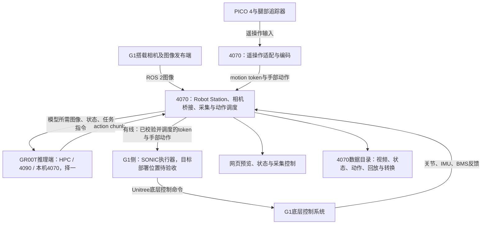

# Robot Station 计算部署与执行分工交接

更新：2026-10-20，Asia/Shanghai。本文记录用户确定的后续架构，供继续实现时首读。**这是部署分工与接口规划，不表示远程推理、G1侧token执行器或两种模式的统一动作入口已完成。** 软件安装包另见 [distribution_plan.md](docs/distribution_plan.md)。

## 用户确定的目标

1. 大模型可以放在HPC GPU服务器、另一台4090工作站，或当前4070上推理。三种位置可配置切换，保持4070工作台和机器人执行侧的动作语义一致。
2. 4070是固定的工作台与机器人接入端，负责网页预览、相机接入、数据采集控制、观测上传、动作接收/校验/调度与有线下发。
3. **目标是G1执行侧接收经过4070处理的motion token和配套手部动作，经SONIC执行；遥操作采集与模型推理共用这条执行路径。** 二者改变动作来源，不各建一套互相竞争的底层控制链路。
4. 尽量复用G1已有板卡、系统和运行环境，不以更换机载硬件、在Orin上部署GR00T为前提。G1还需向4070提供真实机器人状态，以及按实际相机接线提供图像源。

## 角色分工

| 位置 | 职责 | 后续实现边界 |
| --- | --- | --- |
| HPC GPU服务器 | 加载模型、接收观测/任务指令、返回action chunk | 要有可达且能持续服务的GPU任务；排队式批处理不能直接当实时推理端。GPU型号、内存、地址、端口和作业策略待配置 |
| 4090工作站 | 作为另一个模型推理端，接口与HPC一致 | 驱动、权重、模型配置、显存和时延须单独验收；尚未部署验证 |
| 当前4070 | 固定运行Robot Station；三路预览、录制管理、回放/转换；汇合观测、连接所选模型、处理动作、统一调度/下发 | 也可承担模型推理，但必须先证明显存和并行负载满足要求；当前不能标记为GR00T完整推理已就绪 |
| G1机载计算机 | 按相机连接情况发布图像；目标架构下运行兼容的SONIC token接收/解码/执行程序 | 该程序是否已存在、能否复用、算力/依赖/启动和停止行为均待核验。不能假定原厂控制板原生识别motion token |
| G1底层控制系统 | 接收SONIC产生的底层电机命令，反馈关节/IMU/BMS等真实状态 | 继续通过Unitree既有接口和现场控制模式执行；保持唯一控制源 |

大模型选择放在哪里，与G1侧SONIC执行器放在哪里是两个独立部署问题。模型切换只改变4070连接的推理服务，不能隐式启动运动或改变机器人控制权。

## 目标数据流

上传模型的视角按checkpoint的输入配置确定。工作台三路预览/录制不表示每个模型都接受三路图像；当前GR00T `unitree_g1_sonic`参考配置使用ego_view，额外视角接入要同时匹配训练配置。

## 必须区分目标架构和现有部署

目前已验证的软件基础主要位于4070：SONIC Docker/C++程序、图像桥接、工作台与独立Unitree SDK适配。现有SONIC运行路径是在运行C++控制器的主机解码/控制，再经Unitree DDS向G1发送底层电机命令。

| 运行路径 | 4070到G1链路上的控制数据 | 当前判断 |
| --- | --- | --- |
| SONIC执行器继续运行在4070 | Unitree底层关节/电机命令 | 可复用已有部署基础；不是“G1直接接收token”的目标拓扑，尚未真机动作验收 |
| SONIC执行器运行在G1侧 | 4070发送token/手部参考，G1侧解码并产生底层命令 | 用户本次确定的目标；尚未部署/验收G1侧token执行器 |

**要实现“G1端接收motion token”，必须有G1侧兼容执行器。** 若现场没有该程序，后续仍需部署或适配；无需因此更换板卡，但不能承诺机载软件完全不变。若其算力/兼容性不满足，可提出保留4070执行器的替代方案，并明确说明与目标的差异，不擅自把两条路径写成同一已实现功能。本轮不迁移程序、不安装到G1、不改控制器配置。

## 采集与推理共用执行链路

### 遥操作采集

PICO姿态输入 → 4070遥操作适配/重定向及所需SONIC编码 → 统一token/手部动作入口 → 4070调度 → G1侧SONIC执行器 → 实际动作与反馈。

现有遥操作编码位于哪一进程、是否已经对外输出与模型一致的token，须核对SONIC版本并联调，不能把PICO原始人体姿态直接称为模型motion token。应复用匹配的官方编码/解码模型，不能编造转换映射。

4070独立录制图像、真实状态、动作来源及实际发送/执行进度。应区分源输入、模型预测、已经下发的目标和机器人实际反馈。仅开启录制是旁路采样，不因此自动使能运动；PICO跟踪/标定与机器人执行仍有各自就绪条件。

### 模型推理

4070收集新鲜图像/状态与任务指令 → 所选模型端推理 → 返回action chunk → 4070校验、时间对齐、调度与已消费前缀处理 → 同一token/手部动作入口 → G1侧SONIC执行器。

不把整段chunk不加时序处理地直接重放，也不把model prediction当作已执行反馈。未来chunk拼接、重规划和缓冲策略需与所选SONIC客户端版本匹配后验收。

### 控制权

遥操作、模型推理和独立SDK手动关节调试互斥；同一时刻只有一个运动控制源。记录可旁路运行，但采集模式与推理模式在工作台中分别管理并标明来源。独立SDK滑条仍用于SONIC未运行时的机械支撑下链路调试，不并发向G1发布LowCmd。

SONIC自行进入初始姿态按用户说明记录；暂不开发“工作台先摆姿态再自动交给SONIC”的功能，见 [主handoff第0M节](HANDOFF.md)。软件准备保持allow_motion:false，不自动触发初始化/运动。

## 动作与通信合同（待实现时固定）

- GR00T `UNITREE_G1_SONIC`参考动作由64维motion token及左右各7维手部关节组成，共78维。最终字段、形状、单位、归一化/反归一化与手部型号必须按实际checkpoint和SONIC版本确认；不能直接套用独立SDK的29维身体关节目标。
- action chunk需具备可追溯的会话/任务、动作来源、递增序号、对应观测标识/时间、步长/执行周期、有效期，以及模型/统计量/编码器版本。这里是合同要求，不表示现有API已有这些字段。
- 4070负责输入形状/有限数值/语义版本校验，按匹配策略裁去过期或已消费前缀；拒绝旧会话、重复/乱序和过期目标。模式切换后清理旧源的待执行动作，不能自动抢占。
- 模型推理频率、参考动作消费频率与SONIC底层控制频率分别配置/测量；不能把action chunk长度、网页刷新率或相机帧率当成电机控制周期。
- 4070与G1侧执行器分别检查新鲜度与看护超时。服务器断线、相机/状态过期、4070掉线、执行器重启和网络抖动时的模式转换/停止策略，必须按SONIC能力和实际支撑/平衡场景验证；不能直接沿用独立手动调试的阻尼退出策略作为自由站立保证。

## 网络和设备接入

- 4070机器人有线口规划为 `192.168.123.100/24`，G1当前地址按用户提供的 `192.168.123.164`；工作台入口为 `http://192.168.123.100:9999/`。真实链路、地址冲突和网卡名称待现场核对。
- 4070另一网络接口连接HPC/4090与PICO所在网络；保留机器人有线网的独立路由。模型流量通过4070汇合，服务器不直接向G1底层DDS发布运动命令。
- 相机ROS 2域当前配置 **99**；Unitree DDS默认 **0**，按机器人实际配置核验；token传输另按匹配的SONIC ZMQ/客户端合同配置。motion token不是Unitree原生DDS电机消息。
- 若图像由G1机载计算机发布，现场确认三路接线、发布程序、topic/type/QoS、时钟、带宽和帧率。默认topic仍是占位值。相同ROS域并不自动解决跨VLAN发现与路由。
- HPC/4090地址、模型服务端口及G1 token执行端口尚未确定，后续采用配置项；不要把官方示例端口或本机localhost默认值直接当作现场配置。本文不保存任何凭据。

## 截至本次的证据与待办

4070上的Isaac-GR00T为N1.7、commit `51d4c89`；Python 3.12.13、PyTorch 2.9.0+cu128，实际CUDA小矩阵运算通过，Flash Attention 2.8.3、TorchCodec 0.8.0、TensorRT 10.15.1.29及GR00T policy模块可导入。项目与默认缓存中未发现可用GR00T权重，未运行推理服务，尚无完整模型加载或动作输出验收。

4070实测约12GB显存。当前官方N1.7文档列出推理16GB以上；本机完整推理需专门测试显存、时延以及与SONIC/采集并行运行时的负载，不承诺可用，也不据此断言绝对无法运行。HPC与4090方案尚未连接验证。

- [ ] 固定G1侧SONIC执行器的部署位置、版本/模型、token输入合同和反馈/停止机制；优先复用已有环境，明确所需机载软件改动。
- [ ] 选定匹配任务、G1/SONIC动作空间及相机输入的checkpoint，准备所需数据/微调结果与统计量；基础模型下载不等于任务能力验收。
- [ ] 接入HPC/4090/本机三种可配置推理端；先做无运动的模型加载、请求/响应、显存和时延测试。
- [ ] 实现4070统一动作来源适配、chunk调度与互斥；验证PICO遥操作和模型输出使用一致的token语义及执行入口。
- [ ] 无真机条件下验证来源切换、过期/乱序/断线、重启清空、录制与回放中的动作来源及真实进度；不能以合成数据替代现场动作验收。
- [ ] 现场完成相机、PICO/腿追标定、真实G1状态/BMS和SONIC闭环、负载及停止行为验收。
- [ ] 功能和约定验收完成后制作Ubuntu `.deb`；若仍未制作/验收，按主handoff第0L节主动提醒。采集质量评分继续暂缓。

## 参考与实现入口

- [Robot Station主handoff](HANDOFF.md)、[独立SDK适配说明](docs/g1_sdk_adapter.md)、[相机/采集接入说明](docs/data_collection_console.md)。
- 4070程序目录：`/home/harry/workspace/robot_station`、`/home/harry/workspace/sonic_deploy`、`/home/harry/workspace/Isaac-GR00T`。
- [官方GR00T硬件要求](https://github.com/NVIDIA/Isaac-GR00T/blob/main/getting_started/hardware_recommendation.md)、[官方SONIC VLA部署流程](https://github.com/NVlabs/GR00T-WholeBodyControl/blob/main/docs/source/tutorials/vla_inference.md)。后续以实际固定的代码/模型版本核对，避免直接套用更新后的main分支行为。
